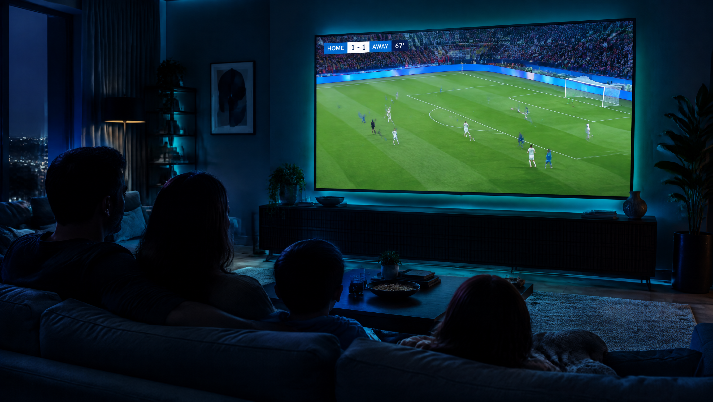
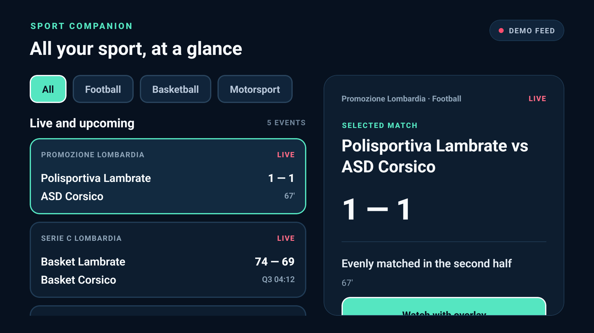
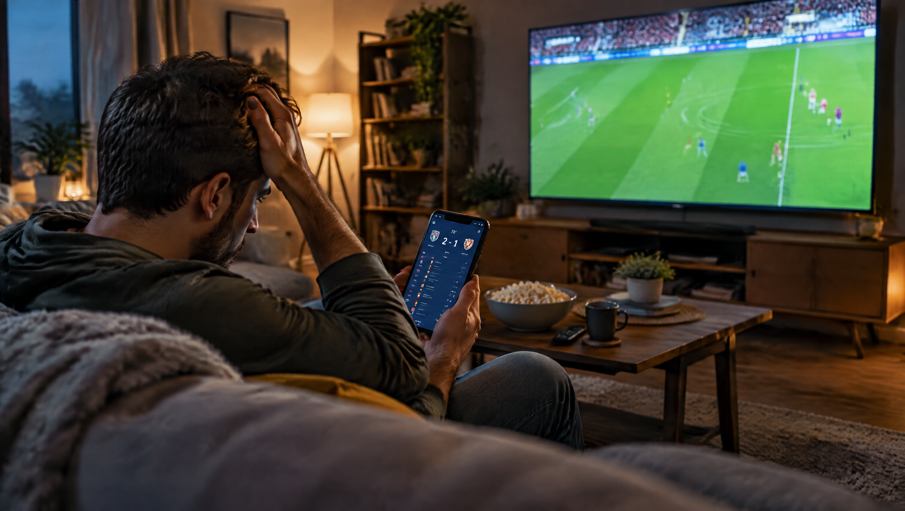
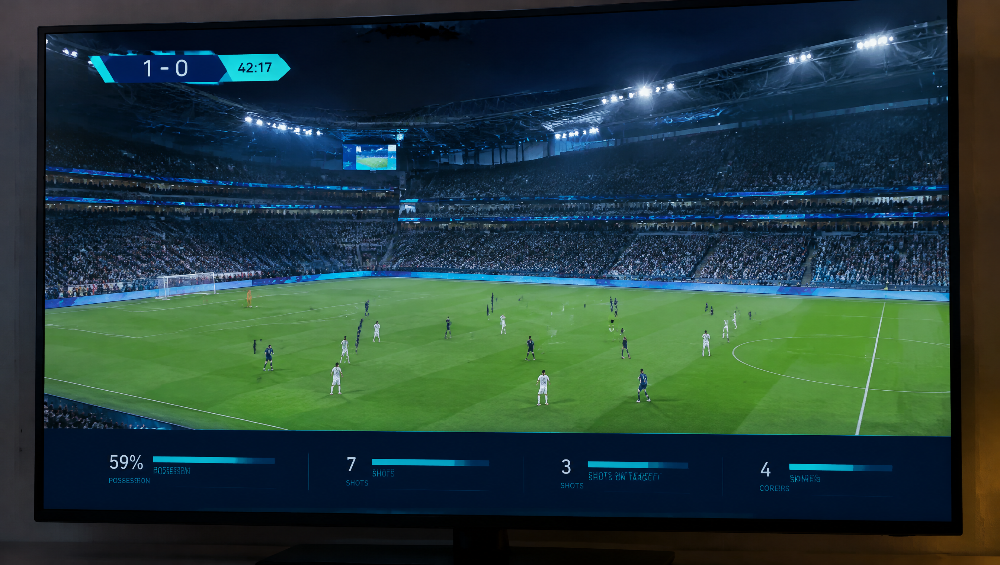
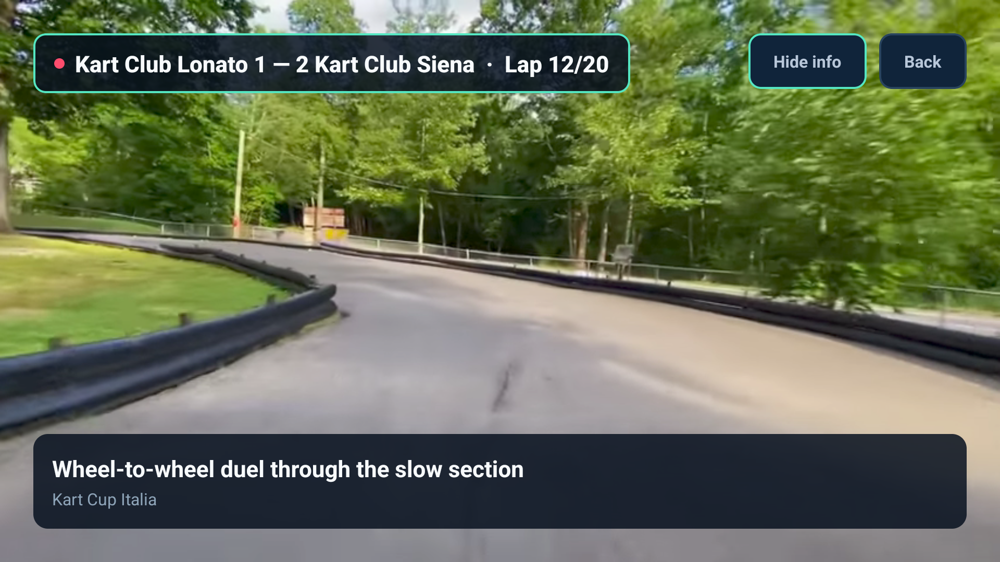
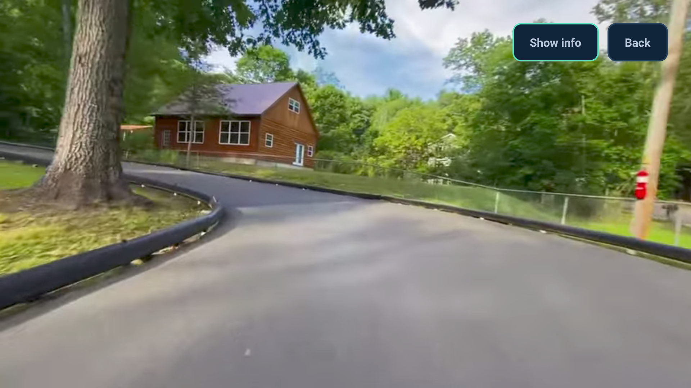
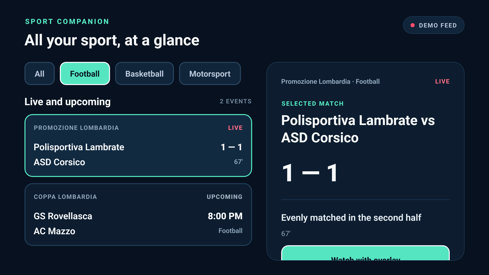
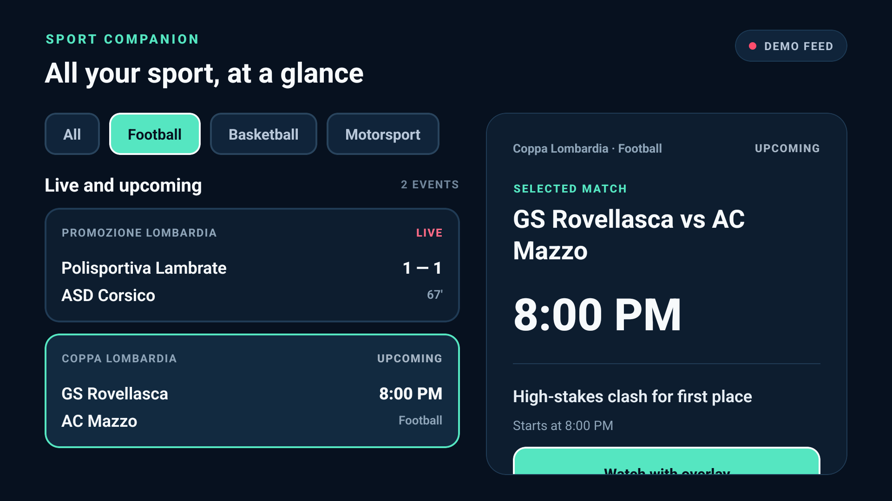
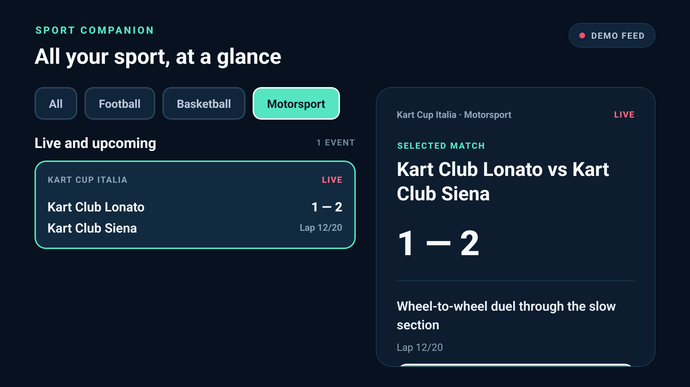

# Sport Overlay for Fire TV: pitch deck (10 slides)

> Fire TV track (sports priority category) · Build, Ship, Shape: Amazon Developer Hackathon 2026
> Expo + React Native TV · landscape 10-foot UI · D-pad native · bundled demo feed, no backend

---

## Slide 1: Title
**Sport Overlay for Fire TV**
*A TV-first companion for live minor-league sport: the score on top of the match, the remote in hand.*

- Football, basketball and motorsport (karting) on one screen
- Built for Fire OS with React Native TV
- Remote-first: arrows and OK, no typing
- Repo: https://github.com/AliceMessi/amazon-sport-overlay


*AI-generated concept render.*



---

## Slide 2: The problem
**Minor-league fans get the worst apps.**

- Scores are buried in menus, built for phones and not for the couch.
- Video is region-locked or interrupted by ads.
- TV guides show one match at a time, with no glanceable live view across sports.


*AI-generated concept render.*

---

## Slide 3: Who feels it
- **Families and casual fans:** want one calm "what's on now" screen.
- **Amateur clubs and local leagues:** players, parents and supporters who follow several games on the same evening.
- **Fire TV owners:** a capable living-room device, underused for live companion experiences.
- Insight: a 10-foot UI must be readable from the couch and usable with five buttons.

---

## Slide 4: The solution
**A calm, remote-driven sports companion for Fire TV.**

- One landscape screen: filters along the top, events on the left, the selected match on the right.
- Live badges, scores, period (67', Q3 04:12, Lap 12/20) and headline. Upcoming games show their kick-off time.
- **Watch with overlay:** the match plays fullscreen with the score bug and headline on top. **Hide info** gives clean video, **Back** returns.


*AI-generated concept render.*

---

## Slide 5: Watch with overlay
- One overlay engine for every sport: the score bug at the top left, a headline bar at the bottom, and Hide/Show info.
- Each sport plays its own freely licensed Wikimedia Commons clip (CC0 / CC BY-SA). There are no region blocks, no ads and no professional-league footage.
- Native playback uses `expo-video`; the web build uses `<video>` with a fallback source.




---

## Slide 6: Filter, focus, detail
1. Pick a sport: **All / Football / Basketball / Motorsport**. The list filters instantly and the first visible match is selected.
2. **D-pad focus is selection.** Moving over a card updates the detail panel; **OK** opens the overlay.
3. Every control is focusable, with a visible focus ring.




---

## Slide 7: 10-foot and D-pad UX
- Landscape-first, large type and high contrast (`#07111F` / `#F7FAFC`). The focus ring is always visible.
- No keyboard or touch assumptions. A Leanback launcher entry and a 320×180 banner come from a custom Expo config plugin.
- The same code adapts to phones (a single column) and the web.



---

## Slide 8: Architecture
```
App.tsx -> LiveSportsScreen (dashboard) -> MatchOverlayScreen (video + overlay)
src/state/sportsDashboard.ts   pure reducer: filter, select, wrap-around
src/data/demoMatches.ts        5 demo events, amateur clubs only
src/screens/videoSource.ts     one Commons clip per sport
plugins/withFireTv.js          Fire OS manifest: Leanback, banner, permissions
```
- Expo SDK 57, React 19, react-native-tvos 0.86 and TypeScript.
- `npm run verify` runs typecheck, ESLint and 32 Jest tests, all green.

---

## Slide 9: Why it fits the Fire TV track
- It targets **sports**, a listed priority category.
- It runs on Fire OS: a release APK, the Leanback launcher, D-pad navigation.
- Judging needs no setup: sideload the APK, or open the web preview. No keys or accounts.
- It is open source (MIT) with a public repo, built during the hackathon window.

---

## Slide 10: Roadmap
- **Now:** a demo feed, three sports, D-pad navigation and the video overlay.
- **Next:**
  - live scores from local league feeds;
  - an Alexa+ voice shortcut ("who's winning?");
  - favourites and kick-off reminders;
  - club-provided streams in place of the demo clips.
- **Try it:** [APK on GitHub Releases](https://github.com/AliceMessi/amazon-sport-overlay/releases/latest) · [web preview](https://alicemessi.github.io/amazon-sport-overlay/) · [demo video](https://youtu.be/_W1ze9UiZrk)

---
*Screenshots 01–07 come from the release APK on an Android TV emulator (1920×1080); 08 is the web build at phone size. The concept renders are AI-generated.*
